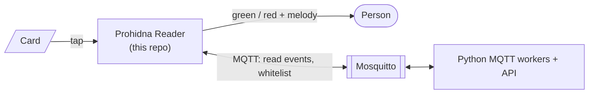

# Prohidna Reader

ESP32-S3 firmware for the NFC entrance reader of **Prohidna**, the school entrance control platform.

A person taps a card. The reader checks the card's UID against a whitelist cached on the device, lights the ring green or red, plays a short melody, and reports the read to the platform backend over MQTT. The decision and the feedback don't depend on the network. Reads made while offline are saved to flash and sent once the connection is back.



## Features

- PN532 NFC reader (ISO 14443A); reads an optional legacy 64-bit code from MIFARE Classic block 4
- Access decision on the device, using a whitelist cached in LittleFS and synced from the backend (single or chunked MQTT messages)
- Feedback on a 24-LED WS2812 ring and a passive buzzer
- Reads saved to a flash outbox while offline and sent when the connection returns
- Ethernet (W5500) first, Wi-Fi as fallback; NTP time sync
- FreeRTOS tasks pinned to both cores, protected by a 30 s task watchdog

## Quick start

Requirements: [PlatformIO](https://platformio.org/) (VS Code extension or `pip install platformio`).

1. Create `include/secrets.h` (it is gitignored and the build fails without it):

   ```cpp
   #pragma once
   #define WIFI_SSID   "school-iot"
   #define WIFI_PASS   "change-me"
   #define MQTT_SERVER "192.168.1.10"
   #define MQTT_PORT   1883
   #define MQTT_USER   "reader"
   #define MQTT_PASS   "change-me"
   ```

2. Build, flash and watch the serial log:

   ```sh
   pio run                          # build
   pio run -t upload -t monitor     # flash + serial console (115200 baud)
   ```

For a local end-to-end test with Mosquitto, see the [development guide](docs/08-development-guide.md#4-local-end-to-end-test-with-mosquitto).

## MQTT interface

| Topic | Direction | Payload |
|---|---|---|
| `device/reader_real/events/read` | reader → backend | `uid:legacy_code:HH-MM-SS:event_id:allowed` |
| `device/reader_real/whitelist/request` | reader → backend | empty |
| `device/reader_real/whitelist/response` | backend → reader | JSON array of UIDs, or `CHUNK:<i>:<total>:<part>` |

The full contract, including delivery guarantees, the chunking rules and the ACL, is in [docs/07-mqtt-contract.md](docs/07-mqtt-contract.md).

## Repository layout

```
platformio.ini      build environment and library dependencies
src/main.cpp        wiring: global objects, setup, FreeRTOS tasks
src/db.cpp          LittleFS outbox
include/            header-only modules (nfc, whitelist, mqtt, network_manager, led, buzzer, ...)
                    pinout headers for the Waveshare (active) and Olimex boards
docs/               developer documentation with diagrams
```

## Documentation

Start at [docs/README.md](docs/README.md). It has a reading path for each audience:

- **Students:** [overview](docs/01-system-overview.md) → [development guide](docs/08-development-guide.md) → [architecture](docs/03-firmware-architecture.md) → [card read flow](docs/04-card-read-flow.md)
- **Mentors:** [architecture](docs/03-firmware-architecture.md), [MQTT contract](docs/07-mqtt-contract.md), [known issues](docs/09-known-issues-and-risks.md)
- **Project management:** [overview](docs/01-system-overview.md), [known issues](docs/09-known-issues-and-risks.md), [roadmap & open questions](docs/10-roadmap-and-open-questions.md)

## Status

This is prototype firmware, not yet ready for a school with several readers:

- Every reader has the same MQTT topic, Ethernet MAC address and credentials.
- There are reliability issues in the offline outbox and in the whitelist sync.
- There are no automated tests.

The ranked list is in [docs/09-known-issues-and-risks.md](docs/09-known-issues-and-risks.md). The suggested order of fixes is in [docs/10-roadmap-and-open-questions.md](docs/10-roadmap-and-open-questions.md).
