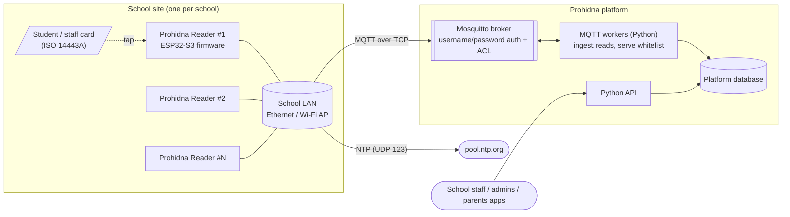
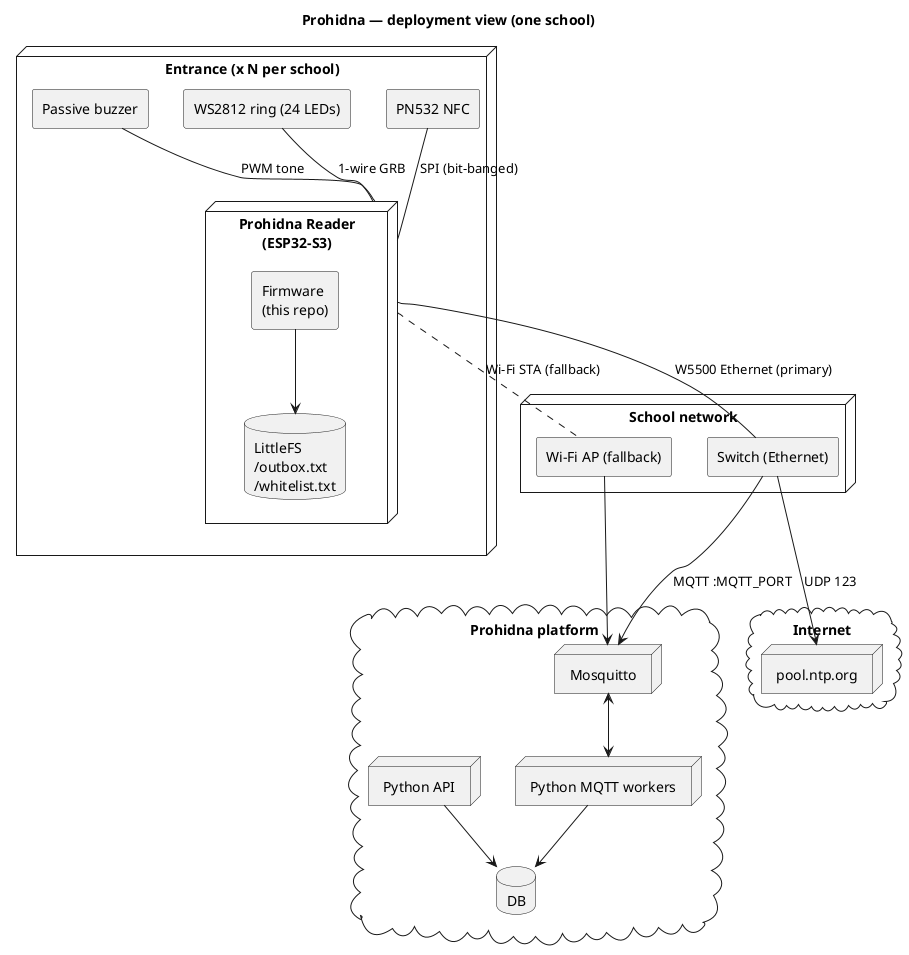

# 01 — System overview

## What the reader does

1. **Reads** an ISO 14443A card (MIFARE Classic / Ultralight / NTAG, etc.) with a PN532 NFC module.
2. **Decides locally** whether the card is allowed, using a whitelist of card UIDs cached in flash and synced from the backend.
3. **Signals** the decision immediately: green ring + rising melody (allowed) or red ring + falling melody (denied).
4. **Reports** every read (allowed *and* denied) to the backend as an MQTT event.
5. **Keeps working offline:** the decision does not need the network, and events are stored in a flash "outbox" and sent later.

The reader does **not** drive a door lock, relay or turnstile; there is no actuator output in the firmware. It is an identification + attendance + feedback terminal. Whether a physical barrier is controlled elsewhere is an [open question](10-roadmap-and-open-questions.md#open-questions).

## Platform context

The reader only talks to two external systems: the **MQTT broker** and an **NTP server**. All business logic beyond "is this UID on the list" lives in the backend.

### Deployment view

## Responsibilities split

| Concern | Reader firmware | Backend (Python API + workers) |
|---|---|---|
| Card identification | Reads UID (+ optional legacy 64-bit code from block 4) | Maps UID / legacy code to a person |
| Access decision | Local, from cached whitelist | Owns and publishes the whitelist |
| Feedback to person | LED ring + buzzer | — |
| Event history / attendance | Emits one event per read, buffers offline | Stores, deduplicates by event id, assigns date |
| Time | NTP → converts uptime to `HH-MM-SS` at send time | Must add the date (payload has none) |
| Device identity | **Hard-coded** (`reader_real`) — see risks | Should map device → school / entrance |

## Tech stack

| Layer | Choice |
|---|---|
| MCU | ESP32-S3 (PlatformIO board profile `esp32s3box`) |
| Framework | Arduino-ESP32 on FreeRTOS, built with PlatformIO (`platform = espressif32`, unpinned) |
| NFC | Adafruit PN532 library |
| LEDs | Adafruit NeoPixel (24 × WS2812, GRB) |
| Networking | Arduino `Ethernet` (W5500 over SPI) + ESP32 `WiFi` |
| Messaging | `PubSubClient` (MQTT 3.1.1, QoS 0 publish) |
| JSON | `ArduinoJson` (v7 API: `JsonDocument`) |
| Storage | LittleFS on internal flash |
| Language | C++ (header-only classes), comments partly in Ukrainian |

## Glossary

| Term | Meaning |
|---|---|
| **UID** | Card's unique identifier. Rendered by the firmware as decimal bytes joined with `-`, e.g. `4-123-55-201`. This exact string is what the whitelist must contain. |
| **Legacy code** | 64-bit number read from MIFARE Classic block 4 (default key `FF…FF`), only for 4-byte-UID cards. `0` when absent. |
| **Whitelist** | Set of allowed UID strings. Delivered by the backend over MQTT, cached in `/whitelist.txt`. |
| **Read event / record** | One line `uid:code:millis:event_id:allowed` created per accepted tap. |
| **Outbox** | `/outbox.txt` on flash; read events that could not be published yet. |
| **Event id** | 16-hex-digit random id (`generateUUID()`), the idempotency key for the backend. |
| **Stable network** | `NetworkManager::isStable()` — Ethernet or Wi-Fi is connected. |
| **WDT** | ESP32 task watchdog, 30 s, resets the chip if a watched task stops checking in. |

## Project status (for planning)

| Area | State |
|---|---|
| Core flow (read → decide → feedback → report) | Implemented |
| Offline operation (cached whitelist, outbox) | Implemented, with reliability gaps (see 09 #1, #3, #4) |
| Ethernet/Wi-Fi failover, NTP | Implemented |
| Multi-reader deployment (per-device identity) | **Not implemented** — blocker for "many readers per school" |
| Security (TLS, per-device credentials) | **Not implemented** |
| Second hardware variant (Olimex ESP32-POE) | Code present, not buildable without changes |
| Automated tests / CI | None |
| OTA firmware update, remote config, device health telemetry | None |
