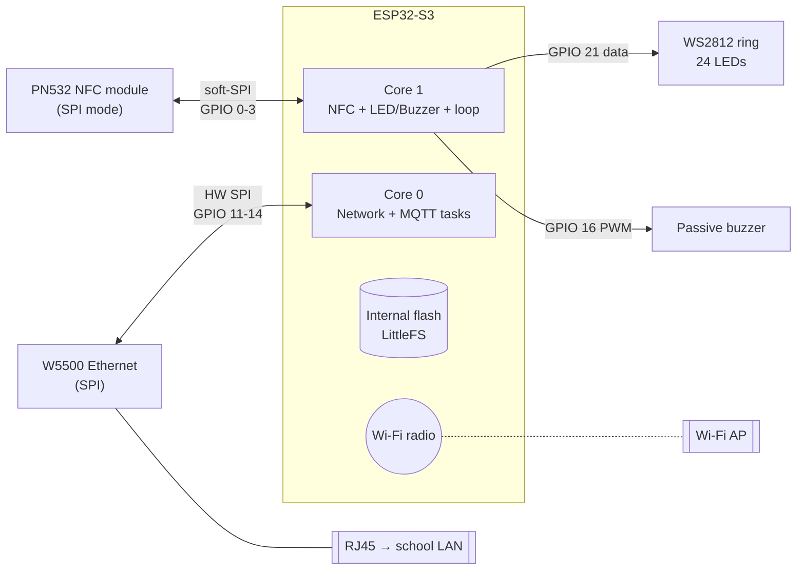

# 02 — Hardware

Two board variants exist in the repo. Which one is the production target is **not decided yet** (see [open questions](10-roadmap-and-open-questions.md#open-questions)).

| | Variant A — Waveshare (built today) | Variant B — Olimex (alternative) |
|---|---|---|
| Pin map | [`include/waveshare_pinout.h`](../include/waveshare_pinout.h) | [`include/olimex_pinout.h`](../include/olimex_pinout.h) |
| Network driver | [`include/network_manager.h`](../include/network_manager.h) | [`include/network_manager_olimex.h`](../include/network_manager_olimex.h) |
| MCU | ESP32-S3 | ESP32 (classic) — implied by RMII pins/GPIO0 clock |
| Ethernet | WIZnet W5x00 on SPI (pin set matches Waveshare ESP32-S3-ETH, W5500) | LAN8720 PHY over RMII (pin set matches Olimex ESP32-POE / POE-ISO) |
| Wi-Fi | On-chip, fallback | On-chip, fallback |
| Wired into `main.cpp` | **Yes** | No — see [switching variants](08-development-guide.md#switching-hardware-variant) |

> The PlatformIO env is named `esp32dev` but uses `board = esp32s3box` (the Espressif ESP32-S3-BOX dev kit profile). Flash size/PSRAM settings of that profile may not match the real board. Confirm the exact board and add a matching profile.

## Block diagram



## Variant A — Waveshare ESP32-S3 + W5500 (active)

| Signal | GPIO | Define | Used by |
|---|---|---|---|
| PN532 SCK | 3 | `NFC_SCLK` | `Nfc` |
| PN532 MOSI | 1 | `NFC_MOSI` | `Nfc` |
| PN532 MISO | 2 | `NFC_MISO` | `Nfc` |
| PN532 SS | 0 | `NFC_CS` | `Nfc` |
| WS2812 data | 21 | `LED` | `Led` |
| LED count | 24 | `LED_NUM` | `Led` |
| Buzzer | 16 | `BUZZER` | `Buzzer` |
| ETH SPI MISO | 12 | `ETH_SPI_MISO_PIN` | `NetworkManager` |
| ETH SPI MOSI | 11 | `ETH_SPI_MOSI_PIN` | `NetworkManager` |
| ETH SPI SCK | 13 | `ETH_SPI_SCLK_PIN` | `NetworkManager` |
| ETH CS | 14 | `ETH_SPI_CS_PIN` | `NetworkManager` |
| ETH RST | 9 | `ETH_RST_PIN` | *defined, unused* |
| ETH INT | 10 | `ETH_INT_PIN` | *defined, unused* |

```
                 ┌──────────────────────────────┐
  PN532 (SPI)    │        ESP32-S3 board        │      W5500 (on board)
  ┌─────────┐    │                              │     ┌──────────┐
  │ SCK  ───┼────┤ GPIO3          GPIO13 ├──────┼─────┤ SCK      │
  │ MOSI ───┼────┤ GPIO1          GPIO11 ├──────┼─────┤ MOSI     │
  │ MISO ───┼────┤ GPIO2          GPIO12 ├──────┼─────┤ MISO     │
  │ SS   ───┼────┤ GPIO0          GPIO14 ├──────┼─────┤ CS       │
  │ VCC/GND │    │                GPIO9  ├ ─ ─ ─┼ ─ ─ ┤ RST (n/c)│
  └─────────┘    │                GPIO10 ├ ─ ─ ─┼ ─ ─ ┤ INT (n/c)│
                 │                              │     └──────────┘
  WS2812 ring    │                              │
  DIN ───────────┤ GPIO21                       │
  Buzzer (+) ────┤ GPIO16                       │
                 └──────────────────────────────┘
```

Notes:

- **PN532 must be switched to SPI mode** (DIP switches / solder jumpers on the module).
- The PN532 is driven with the 4-pin constructor `Adafruit_PN532(SCK, MISO, MOSI, SS)`, which is **software (bit-banged) SPI**, independent of the hardware SPI bus used by the W5500. The comment in the pinout file mentioning "HSPI" is inaccurate.
- GPIO0 is a strapping pin on ESP32-S3 (boot mode). Using it as PN532 SS works only if the module doesn't pull it low during reset. If a board refuses to boot with the reader attached, check this first.
- GPIO 0–3 on the S3 also include strapping (GPIO3 = JTAG select). Keep this in mind when changing the wiring.

## Variant B — Olimex ESP32-POE (LAN8720, RMII)

| Signal | GPIO | Define |
|---|---|---|
| PN532 SCK / MOSI / MISO / SS | 16 / 14 / 15 / 13 | `NFC_*` |
| WS2812 data | 2 | `LED` |
| Buzzer | 4 | `BUZZER` |
| ETH MDC / MDIO | 23 / 18 | `ETH_MDC_PIN`, `ETH_MDIO_PIN` |
| ETH PHY power | 12 | `ETH_POWER_PIN` |
| ETH PHY address | 1 | `ETH_PHY_ADDR` |
| RMII clock | GPIO0 input | `ETH_CLK_MODE` |

PoE power on this board family would remove the need for a separate power supply at each entrance — a relevant factor for the board decision.

## Feedback hardware behaviour

| Element | Behaviour | Source |
|---|---|---|
| Ring, "loading" | Orange comet with fading tail, rotates (NFC not connected / connecting) | [`include/led.h`](../include/led.h) |
| Ring, "waiting" | Blue "breathing" (sine) — ready for a card | `led.h` |
| Ring, approval | Solid green ~700 ms | `Led::approval(700)` |
| Ring, denial | Solid red ~350 ms | `Led::denial(350)` |
| Ring, "error" | Solid red — **defined but never activated** | `led.h` |
| Buzzer, approval | C4-E4-G4-C5 (rising), ~75 ms notes | [`src/main.cpp:18`](../src/main.cpp#L18) |
| Buzzer, denial | C5-A4-E4-C4 (falling) | `src/main.cpp:21` |

Animation runs at 60 frames/s (`freq = 60`, one frame ≈ 16 ms).

## Bill of materials (per entrance, Variant A)

| Qty | Part | Note |
|---|---|---|
| 1 | ESP32-S3 board with W5500 Ethernet | exact model to confirm |
| 1 | PN532 NFC module (SPI capable) | 13.56 MHz, ISO 14443A |
| 1 | WS2812/NeoPixel ring, 24 LEDs | 5 V; level shifting may be needed from 3.3 V GPIO |
| 1 | Passive piezo buzzer | driven by `tone()`; an active buzzer will not play melodies |
| 1 | Ethernet cable / PoE (if the board supports it) | Wi-Fi is fallback only |
| 1 | 5 V power supply | 24 LEDs at full white can draw >1 A; firmware uses at most single colours |
