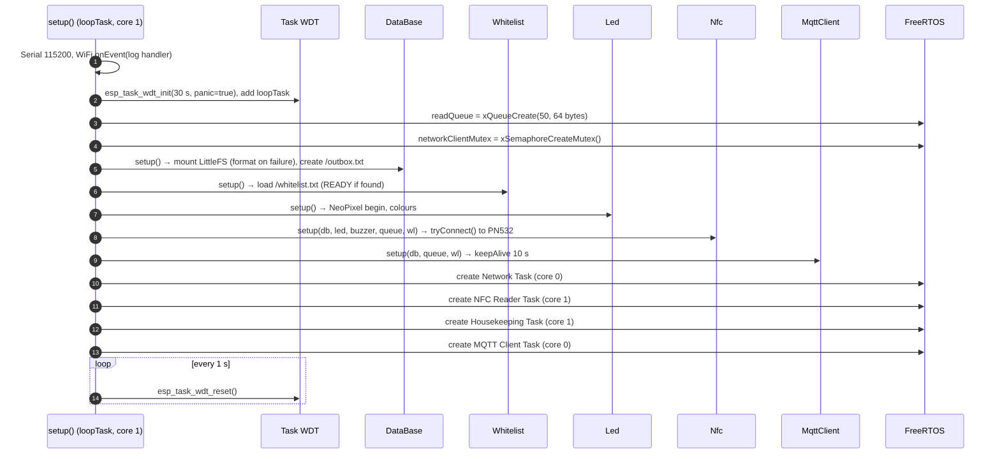
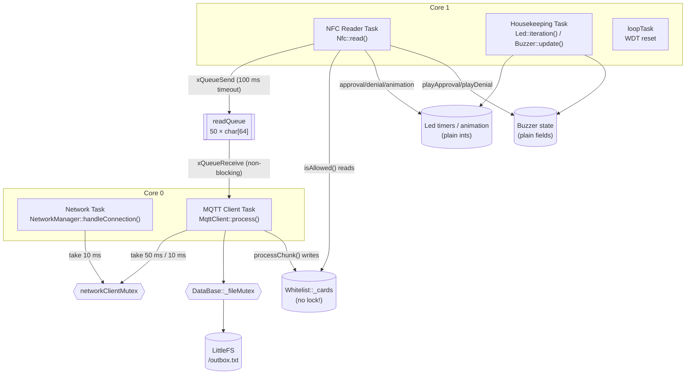
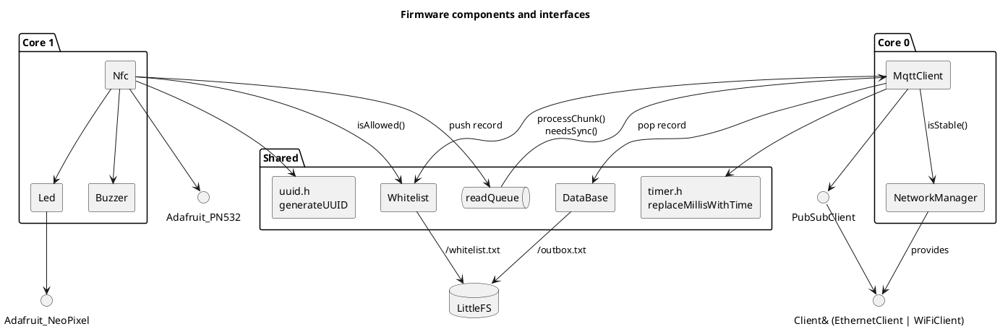

# 03 — Firmware architecture

## Source layout

```
platformio.ini          build env, library dependencies, -D MQTT_QOS=1 (unused)
src/main.cpp            composition root: globals, setup(), task creation
src/db.cpp              DataBase implementation (the only other .cpp)
include/
  nfc.h                 Nfc            — PN532 polling, decision, event creation
  whitelist.h           Whitelist      — allowed-UID set, chunked sync, flash cache
  mqtt.h                MqttClient     — queue drain, publish, outbox replay, whitelist request
  db.h                  DataBase       — LittleFS outbox (declaration)
  network_manager.h     NetworkManager — Ethernet(W5500) ⇄ Wi-Fi failover, NTP   [Variant A]
  network_manager_olimex.h               same class for LAN8720/ETH.h            [Variant B]
  led.h                 Led            — NeoPixel animations
  buzzer.h              Buzzer, Melody — non-blocking melody player
  timer.h               millisToTimeString / replaceMillisWithTime
  uuid.h                generateUUID   — 64-bit random event id
  pitches.h             NOTE_* frequencies
  waveshare_pinout.h / olimex_pinout.h  — pin maps
  secrets.h             (gitignored) Wi-Fi + MQTT credentials
```

Almost everything is **header-only**: classes are fully defined in `include/*.h`, and only `main.cpp` and `db.cpp` are translation units. This keeps the project simple but means headers that define non-inline symbols (`mqtt.h`, `timer.h`, `network_manager_olimex.h`) can be included by **one** `.cpp` only.

## Module diagram

```mermaid
classDiagram
    direction LR

    class Nfc {
        -Adafruit_PN532 nfc_chip
        -bool is_connected_
        -String last_processed_uid_
        +setup(db, led, buzzer, queue, whitelist)
        +read()
        -tryConnect()
        -healthCheck()
    }
    class Whitelist {
        -set~String~ _cards
        -Status _status
        -String _assemblyBuffer
        +setup()
        +isReady() bool
        +isAllowed(uid) bool
        +needsSync() bool
        +setLoading()
        +processChunk(msg) bool
        +loadFromJson(json) bool
    }
    class MqttClient {
        -PubSubClient mqtt
        -static MqttClient* _instance
        +setup(db, queue, whitelist)
        +process()
        -reconnect()
        -processOutbox()
        -static mqttCallback()
    }
    class DataBase {
        -SemaphoreHandle_t _fileMutex
        +setup()
        +appendRead(line)
        +getAllReads() vector~String~
        +removeSentReads(sent)
    }
    class NetworkManager {
        -State _currentState
        -NetworkType _activeConnection
        +handleConnection()
        +getClient() Client&
        +isStable() bool
        +static taskFunction()
    }
    class Led {
        +State animation
        +approval(ms)
        +denial(ms)
        +iteration()
    }
    class Buzzer {
        +playApproval()
        +playDenial()
        +update()
    }
    class Melody

    Nfc --> Whitelist : isReady / isAllowed
    Nfc --> Led : animation, approval, denial
    Nfc --> Buzzer : playApproval / playDenial
    Nfc ..> MqttClient : readQueue (FreeRTOS queue)
    MqttClient --> DataBase : outbox
    MqttClient --> Whitelist : needsSync / processChunk
    MqttClient --> NetworkManager : isStable / getClient
    Buzzer o-- Melody : approval, denial
```



Note that `Nfc` receives a `DataBase&` in `setup()` but never uses it — persistence is the MQTT task's job.

## Composition root and dependency wiring

[`src/main.cpp`](../src/main.cpp) owns every object as a **global singleton** and wires them by passing references into `setup()` methods ("setter injection"). No module creates another module.



`DataBase::setup()` must run before `Whitelist::setup()` because it is the one that mounts LittleFS.

## Concurrency model

### Tasks

| Task | Entry | Core | Prio | Stack | Period | Watchdog |
|---|---|---|---|---|---|---|
| Network Task | `NetworkManager::taskFunction` | 0 | 1 | 8192 | 500 ms | no |
| MQTT Client Task | `mqttTask` (main.cpp) | 0 | **0** (idle level) | 4096 | 50 ms | **yes** |
| NFC Reader Task | lambda → `nfc.read()` | 1 | 1 | 4096 | 10 ms + read time (≤ ~50 ms) | no |
| Housekeeping Task | `housekeepingTask` → `led.iteration()`, `buzzer.update()` | 1 | 1 | 2048 | ~16 ms (inside `iteration()`) | no |
| Arduino `loopTask` | `loop()` | 1 | 1 | default | 1 s | yes |

`MqttClient::taskFunction` exists but is not used; `main.cpp` has its own `mqttTask`.

### Shared resources



| Resource | Protection | Comment |
|---|---|---|
| `readQueue` | FreeRTOS queue (thread-safe) | The only hand-off between NFC and MQTT. Item size is 64 bytes — see [09 #2](09-known-issues-and-risks.md). |
| Network client / connection switching | `networkClientMutex` | Taken by the network state machine and around MQTT publish/loop/reconnect. Step 3 of `MqttClient::process()` (whitelist request) publishes **without** it. |
| Outbox file | `DataBase::_fileMutex` | All three DB operations lock it. |
| `Whitelist::_cards` | **none** | Written by the MQTT task (callback), read by the NFC task — a data race on `std::set<String>`. See [09 #3](09-known-issues-and-risks.md). |
| `Led` / `Buzzer` fields | none | Simple int/enum writes; worst case is one glitched frame/note. Acceptable. |

### Watchdog

`esp_task_wdt_init(30, true)` — a watched task that does not call `esp_task_wdt_reset()` for 30 s **panics and reboots** the chip. Only `loopTask` and the MQTT task are registered. Anything long-running inside `MqttClient::process()` (connect, outbox replay) must reset the watchdog; `reconnect()` does, `processOutbox()` does not ([09 #1](09-known-issues-and-risks.md)).

## Design patterns and solutions

| Pattern | Where | Why it works here |
|---|---|---|
| **Edge decision with cached policy** | `Nfc` + `Whitelist` | Entrance keeps working when the network/backend is down; feedback is instant (no round-trip). |
| **Producer/consumer via queue** | `Nfc` → `readQueue` → `MqttClient` | NFC task never blocks on the network; slow TCP can't delay feedback to the person at the gate. |
| **Store-and-forward outbox** | `MqttClient` + `DataBase` | Events survive outages and reboots in flash; replayed when the broker is back. |
| **Explicit state machines** | `NetworkManager` (connection), `Whitelist::Status`, `Buzzer::State`, `Led::animation` | Non-blocking, testable logic driven by periodic ticks. |
| **Cooperative tick functions** | `handleConnection()`, `process()`, `iteration()`, `update()` | Each task is a `for(;;){ tick(); vTaskDelay(); }` loop; ticks avoid long blocking. |
| **Primary/fallback link** | `NetworkManager` | Ethernet first, Wi-Fi as fallback, with a cool-down between attempts. |
| **Idempotency key** | `generateUUID()` in each event | Lets the backend deduplicate replays. |
| **Self-healing peripheral** | `Nfc::healthCheck()` / `tryConnect()` | PN532 unplug/brown-out is detected every 2.5 s and the module is re-initialised. |
| **Static-instance trampoline** | `MqttClient::_instance` for `PubSubClient` C-style callback | Standard way to reach object state from a plain function pointer. |
| **Composition root + setter injection** | `main.cpp` | All wiring in one place; modules depend on references, not globals (except `networkClientMutex`). |

## Component view (PlantUML)


