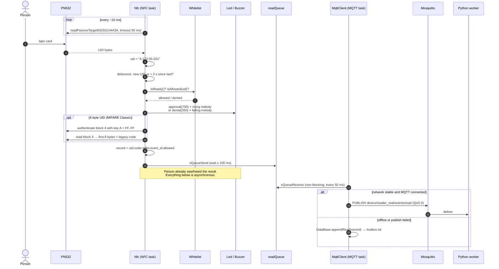
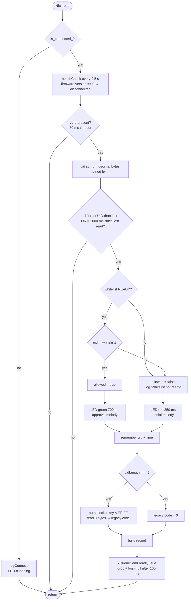
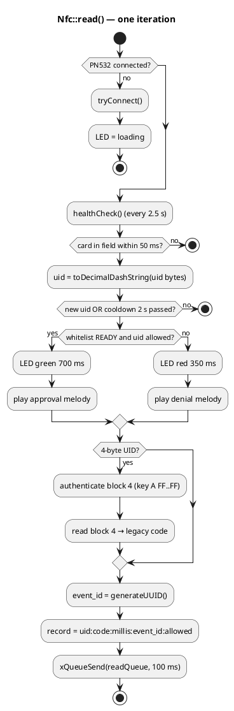
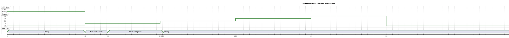
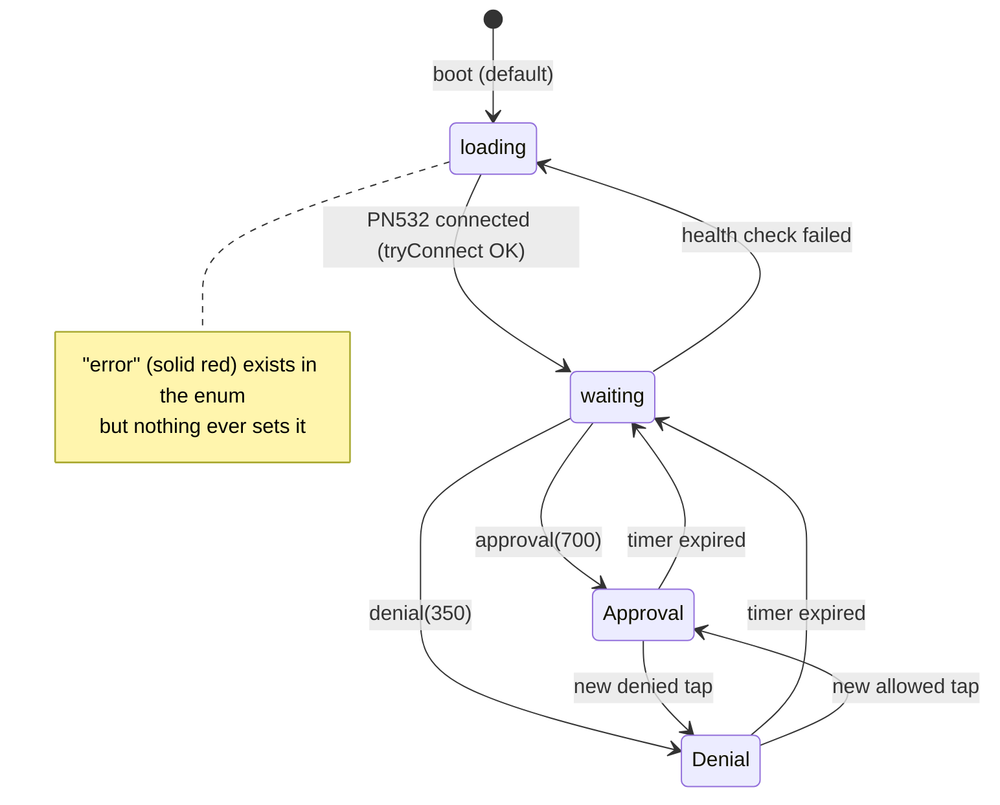

# 04 — Card read flow

Everything in this document happens in the **NFC Reader Task** (core 1) inside [`Nfc::read()`](../include/nfc.h#L87), except the final publish which the MQTT task does asynchronously.

## End-to-end sequence



## Decision logic



Key points:

- **Fail-closed:** if the whitelist is not `READY` (never synced and no cache, or a sync is in progress) every card is **denied** — and the denial is reported to the backend as `allowed=0`.
- **Debounce** ([`CARD_READ_COOLDOWN_MS = 2000`](../include/nfc.h#L14)): holding the same card on the reader produces one event every 2 s; a different card is processed immediately.
- Feedback is given **before** the legacy-code read and the queue push, so the person never waits for flash or network.
- `Buzzer::playApproval()/playDenial()` are ignored while a melody is still playing, so two fast taps give two light flashes but only one melody.

## Record format

Built in [`nfc.h`](../include/nfc.h#L170) as a colon-separated string:

```
<uid>:<legacy_code>:<millis>:<event_id>:<allowed>
```

| Field | Example | Description |
|---|---|---|
| `uid` | `4-123-55-201` | Card UID bytes in **decimal**, `-` separated. 4 bytes (Classic) or 7 bytes (Ultralight/NTAG/DESFire). |
| `legacy_code` | `0` / `1234567890123` | Unsigned 64-bit from block 4, decimal; `0` if not a 4-byte card or auth/read failed. |
| `millis` | `5234012` | `millis()` at read time (uptime). **Replaced with `HH-MM-SS` just before publishing** — see [05](05-storage-outbox-and-time.md#timestamp-handling). |
| `event_id` | `3f9a1c0e5b7d2a41` | 16 hex chars from `esp_random()`; idempotency key. |
| `allowed` | `1` / `0` | Local decision. |

Length budget: the queue item is **64 bytes including the terminating NUL**. A 4-byte UID with a large legacy code can exceed 63 characters (15 + 20 + 8 + 16 + 1 + 4 separators = 64), which overflows the item — [09 #2](09-known-issues-and-risks.md).

## Activity view (PlantUML)



## Feedback timing



Times are in ms and approximate: each note lasts `300 / 4 = 75 ms` followed by a gap so the next note starts ~97 ms later; the green fill lasts `700 / 16` ≈ 43 frames.

## LED animation state



Approval/denial are overlays (timers) drawn on top of the base `animation`; when the timer reaches zero the base animation shows again.
