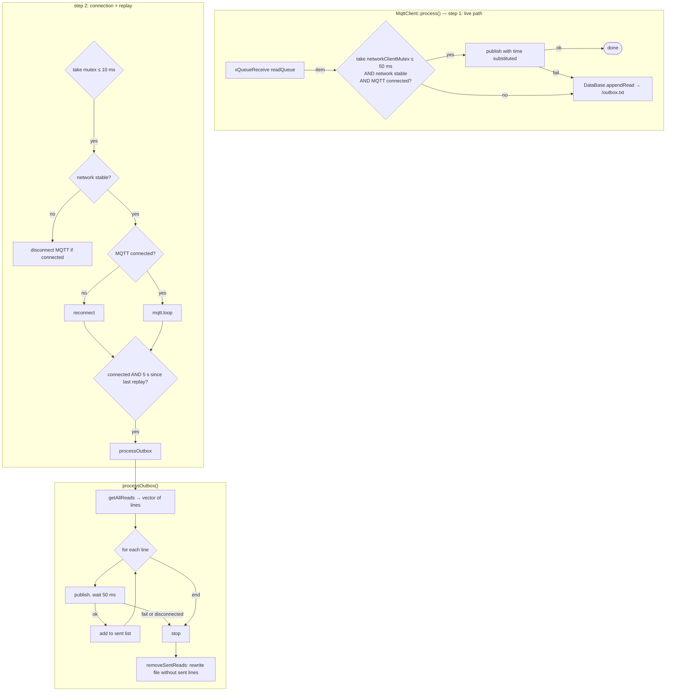
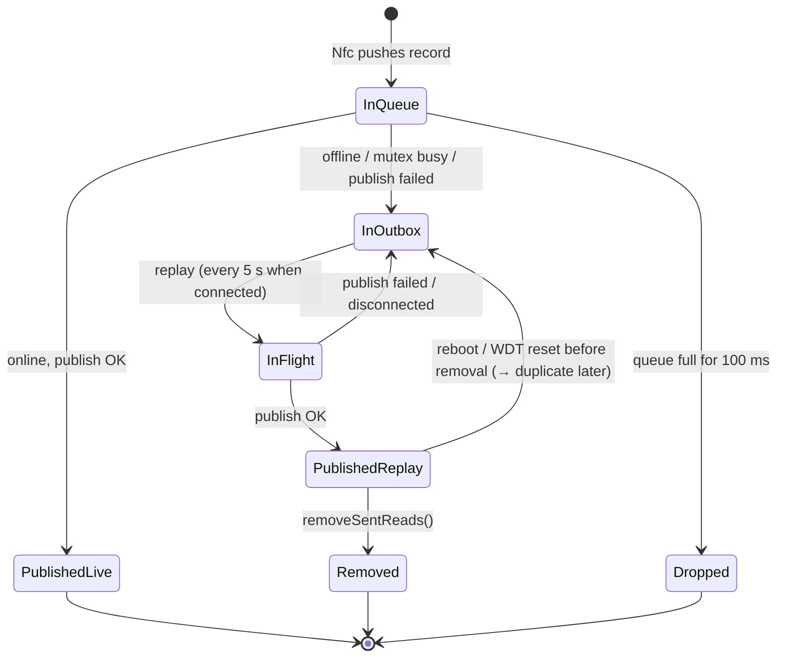
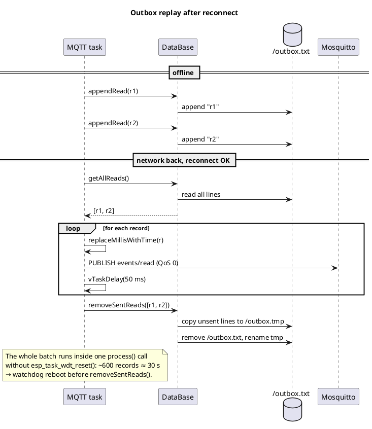
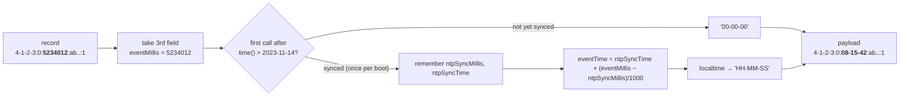

# 05 — Storage, outbox & time

## Flash layout (LittleFS)

| File | Owner | Format | Lifetime |
|---|---|---|---|
| `/outbox.txt` | `DataBase` ([`src/db.cpp`](../src/db.cpp)) | One read record per line (`uid:code:millis:event_id:allowed`) | Grows while offline, shrinks after successful replay |
| `/outbox.tmp` | `DataBase` | Temporary copy during cleanup | Renamed over `/outbox.txt` |
| `/whitelist.txt` | `Whitelist` ([`include/whitelist.h`](../include/whitelist.h)) | One allowed UID per line | Rewritten on each successful whitelist sync |

LittleFS is mounted by `DataBase::setup()` with `format = false`; only if mounting fails is the partition formatted (this wipes both files). A full flash erase (`pio run -t erase`) also wipes them.

## Store-and-forward outbox

The reader publishes **live** when it can, and falls back to the outbox when it cannot. A separate replay step drains the outbox every 5 s while connected.

### Record lifecycle

### Delivery guarantees (what the backend can rely on)

| Property | Value | Why |
|---|---|---|
| Survives reboot / power loss | Yes, once written to `/outbox.txt` | LittleFS append + `close()` |
| Lost in RAM | Up to 50 queued records on reboot; records dropped when the queue is full | `readQueue` is RAM only |
| Duplicates | **Possible** — replayed records are removed only after the whole batch | Backend must dedupe on `event_id` |
| Order | **Not guaranteed** — a live read can be published before older outbox records | Backend must not assume arrival order |
| Network delivery | QoS 0 ("at most once" per publish attempt) | `PubSubClient::publish()` is QoS 0; `-D MQTT_QOS=1` is unused |

### DataBase implementation notes

- All methods lock `_fileMutex` (a FreeRTOS mutex), so the outbox is safe even if more tasks start using it.
- `removeSentReads()` copies every line that is **not** in the sent list into `/outbox.tmp`, then deletes the original and renames. Complexity O(lines × sent). A power cut between `remove` and `rename` loses the outbox; LittleFS has no atomic replace for this.
- `getAllReads()` loads the **whole outbox into RAM** as `std::vector<String>`. A long outage (thousands of reads) can exhaust the heap — [09 #9](09-known-issues-and-risks.md).

## Sequence: replay after an outage

## Timestamp handling

The reader has no RTC. Time comes from NTP after a network connection (see [06](06-networking.md#ntp)). Records store **uptime** (`millis()`) and are converted to wall-clock time **at publish time** by [`replaceMillisWithTime()`](../include/timer.h):

Consequences the backend must know:

1. **No date** in the payload — only `HH-MM-SS`. The backend has to assume the date from the receive time. Records replayed after midnight get the wrong day.
2. **Reboot breaks old records:** `millis()` restarts at 0, but outbox lines keep the previous boot's uptime. After a reboot those records are converted against the *new* boot's sync point → wrong time.
3. **`00-00-00`** is sent if the clock has never been synced in this boot (e.g. published before NTP succeeded).
4. **Time zone** is a fixed UTC+2 without daylight saving (`GMT_OFFSET_SEC = 7200`, `DAYLIGHT_OFFSET_SEC = 0`). During Eastern European Summer Time (UTC+3) times are one hour behind local time.
5. The sync point is captured lazily on first conversion; the backend cannot tell from the payload whether the time is trustworthy.

Recommended fix (see [10](10-roadmap-and-open-questions.md)): store an absolute epoch timestamp when the time is known, otherwise store `millis` + a boot id, and send ISO 8601 UTC.
