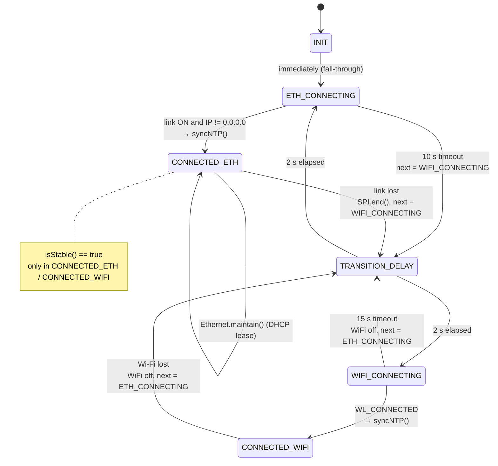
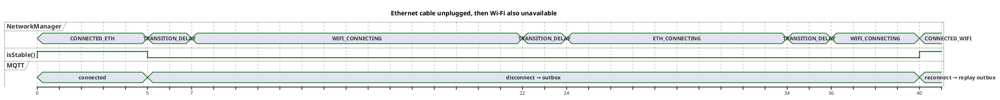
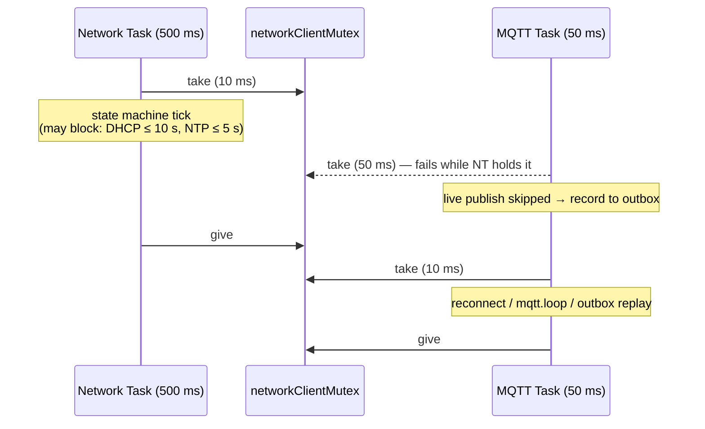

# 06 — Networking

`NetworkManager` ([`include/network_manager.h`](../include/network_manager.h)) runs in its own task on core 0 and ticks every 500 ms. It owns link selection (Ethernet first, Wi-Fi fallback), DHCP and NTP. Other modules only ask two things: `isStable()` and `getClient()`.

## Connection state machine

Behaviour worth knowing:

- **No fail-back.** Once on Wi-Fi the reader stays on Wi-Fi until Wi-Fi drops, even if the Ethernet cable is plugged back in.
- **Blocking DHCP.** On entering `ETH_CONNECTING`, `Ethernet.begin(mac, 10000)` blocks up to 10 s while holding `networkClientMutex`. During that time the MQTT task cannot take the mutex, so new reads go straight to the outbox. That is safe, just slower.
- **Wi-Fi credentials are printed to the serial log** on every Wi-Fi attempt ([`network_manager.h:149`](../include/network_manager.h#L149)). Anyone with a USB cable can read the password.
- **Fixed MAC** `0A:8A:DA:11:42:01` ([`network_manager.h:34`](../include/network_manager.h#L34)) for Ethernet. Two readers on the same LAN segment will conflict — a blocker for multi-reader schools ([09 #5](09-known-issues-and-risks.md)).
- The task itself is **not** registered with the watchdog.

## Failover timeline

(Seconds. Cable pulled at t = 5 s; Wi-Fi AP comes back at t ≈ 40 s.)

## Mutex usage between network and MQTT

The mutex prevents the MQTT task from using a `Client` while the network manager is tearing it down (e.g. `SPI.end()` on Ethernet loss). Because `getClient()` returns `EthernetClient` or `WiFiClient` depending on the active link, MQTT re-binds the client on every `reconnect()`.

## NTP

| Link | Method | Notes |
|---|---|---|
| Wi-Fi | `configTime(7200, 0, "pool.ntp.org")` + `getLocalTime(5 s)` | ESP-IDF SNTP; keeps re-syncing in the background |
| Ethernet (W5500) | Manual NTP request over `EthernetUDP` (local port 8888), `settimeofday()`, `TZ=STD-2` | One-shot at connect time; no periodic re-sync while the link stays up |

The W5500 has its own TCP/IP stack (not lwIP), so the IDF SNTP client cannot use it. That is why the Ethernet path builds the 48-byte NTP packet by hand. The Olimex variant uses the ESP32's internal MAC + lwIP, so `configTime()` works for both links there.

Requirements for the school network:

- UDP 123 outbound to `pool.ntp.org` must be allowed, or the NTP server must be changed to a local one (it is a compile-time constant).
- DHCP must be available on the Ethernet segment (no static IP support).
- TCP to the broker at `MQTT_SERVER:MQTT_PORT`.

## Olimex variant differences

[`network_manager_olimex.h`](../include/network_manager_olimex.h) keeps the same states and public API but:

- Uses `ETH.begin(...)` (LAN8720, RMII) and reacts to `ARDUINO_EVENT_ETH_GOT_IP` / `ETH_DISCONNECTED` events via a static `_instance` pointer.
- Needs `networkManager.setup()` to register those event handlers — `main.cpp` does not call it today.
- Returns a single `WiFiClient` for both links (lwIP serves both).
- Uses `configTime()` for NTP on both links.
