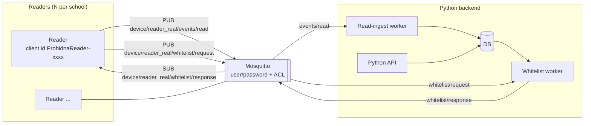
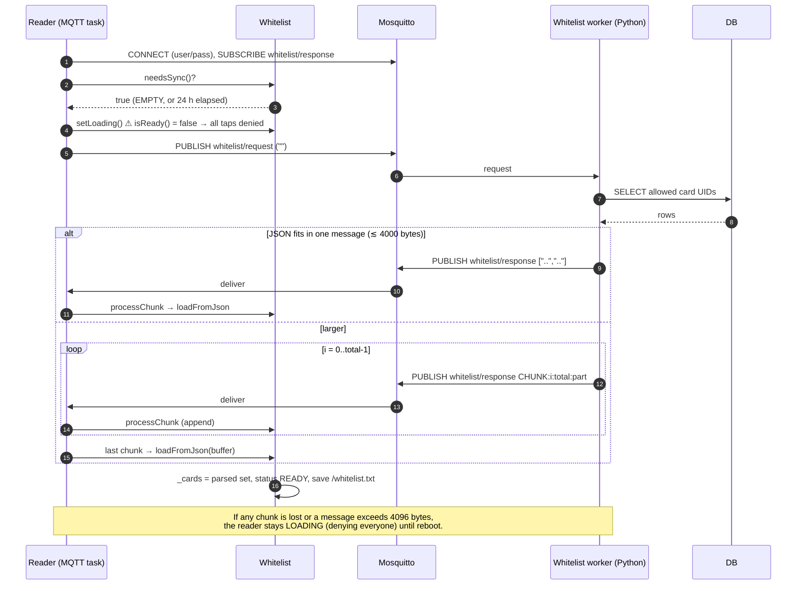
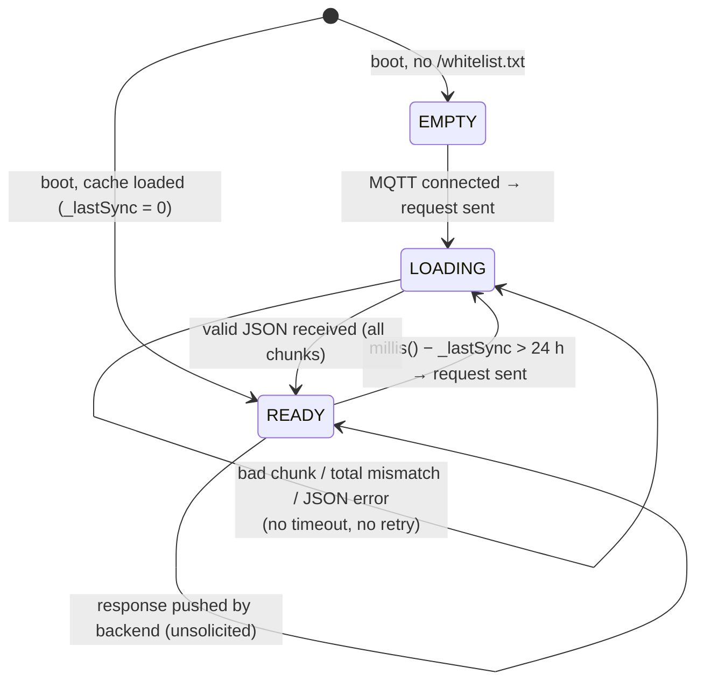

# 07 — MQTT contract (reader ⇄ backend)

This is the **only** interface between the reader and the rest of the platform. Backend developers (Python API / MQTT workers) should treat this page as the integration spec; firmware developers must update it whenever topics or payloads change.

## Participants



## Connection parameters

| Parameter | Value | Source |
|---|---|---|
| Protocol | MQTT 3.1.1 over plain TCP (**no TLS**) | `PubSubClient` |
| Broker address | `MQTT_SERVER`, `MQTT_PORT` from `secrets.h` (compile-time) | [`src/main.cpp:34`](../src/main.cpp#L34) |
| Credentials | `MQTT_USER` / `MQTT_PASS` from `secrets.h` — **same for every reader built with the same file** | |
| Client id | `ProhidnaReader-<random 0..ffff hex>`, new on every reconnect | [`include/mqtt.h:73`](../include/mqtt.h#L73) |
| Clean session | yes (PubSubClient default) — no queued messages while offline | |
| Keep-alive | 10 s | `mqtt.setKeepAlive(10)` |
| Socket timeout | 5 s | `netClient.setTimeout(5)` |
| Last Will | none | |
| Max incoming packet | 4096 bytes (`setBufferSize(4096)`) — larger messages are **silently dropped** | [`include/mqtt.h:80`](../include/mqtt.h#L80) |
| Publish QoS | 0 | `PubSubClient::publish` |
| Subscribe QoS | 0 | `mqtt.subscribe(topic)` |
| Retained | not used by the reader | |

## Topics

`reader_real` is a **hard-coded device id** shared by every reader ([`include/mqtt.h:23`](../include/mqtt.h#L23)).

| Topic | Direction | Payload | When |
|---|---|---|---|
| `device/reader_real/events/read` | reader → backend | Read event (text, see below) | Every accepted card tap, live or replayed from outbox |
| `device/reader_real/whitelist/request` | reader → backend | empty | Whitelist is EMPTY at boot, or 24 h since last successful sync |
| `device/reader_real/whitelist/response` | backend → reader | JSON array **or** `CHUNK:` frames | In response to a request, **or pushed at any time** |

### Read event payload

```
<uid>:<legacy_code>:<HH-MM-SS>:<event_id>:<allowed>
```

Example: `4-123-55-201:0:08-15-42:3f9a1c0e5b7d2a41:1`

| Field | Type | Notes for the backend |
|---|---|---|
| `uid` | string, decimal bytes joined by `-` | Must match whitelist entries **exactly** (same format). |
| `legacy_code` | uint64 decimal | `0` = none. Only for 4-byte UIDs. |
| `HH-MM-SS` | local time, UTC+2 fixed | **No date.** `00-00-00` = clock not synced. Unreliable for records replayed after a reboot. See [05](05-storage-outbox-and-time.md#timestamp-handling). |
| `event_id` | 16 lowercase hex chars | **Deduplicate on this.** Replays can resend events. |
| `allowed` | `1` / `0` | Local decision. `0` also when the whitelist was not ready. |

Every field avoids `:` (the time uses `-`), so `payload.split(":")` yields exactly 5 fields.

### Whitelist response payload

Two accepted forms ([`Whitelist::processChunk`](../include/whitelist.h#L60)):

1. **Single message** — a JSON array of UID strings: `["4-123-55-201","4-9-200-17","4-1-2-3-4-5-6"]`
2. **Chunked** — the JSON text split into parts, each sent as `CHUNK:<index>:<total>:<part>`:

```
CHUNK:0:3:["4-123-55-201","4-9-2
CHUNK:1:3:00-17","4-1-2-3-4-5-6","4-
CHUNK:2:3:77-88-99-100"]
```

Parts are concatenated **in arrival order** (the index is only logged), and the result is parsed when `total` chunks have arrived. An empty array `[]` is valid and denies everyone.

On success the reader replaces its whole set, marks itself `READY`, writes `/whitelist.txt` and restarts the 24 h timer. There is **no acknowledgement** message.

## Whitelist sync sequence



### Whitelist status machine



Note: after loading the cache at boot `_lastSync = 0`, so `needsSync()` only becomes true after **24 h of uptime** — a rebooted reader keeps using the cached list without asking for a fresh one ([09 #7](09-known-issues-and-risks.md)). The backend can work around this by pushing the whitelist whenever it changes.

## Backend implementation notes (Python)

Illustrative only — adapt to the actual worker framework.

```python
import json

READ_TOPIC = "device/+/events/read"           # '+' ready for per-device ids
WL_RESPONSE = "device/{device}/whitelist/response"
MAX_PAYLOAD = 3500                            # stay well below the reader's 4096-byte buffer

def parse_read(topic: str, payload: bytes) -> dict:
    device = topic.split("/")[1]
    uid, legacy, hhmmss, event_id, allowed = payload.decode().split(":")
    return {
        "device": device,
        "uid": uid,
        "legacy_code": int(legacy) or None,
        "local_time": None if hhmmss == "00-00-00" else hhmmss.replace("-", ":"),
        "event_id": event_id,          # unique key → INSERT ... ON CONFLICT DO NOTHING
        "allowed": allowed == "1",
    }

def whitelist_messages(uids: list[str]) -> list[str]:
    body = json.dumps(uids, separators=(",", ":"))
    if len(body) <= MAX_PAYLOAD:
        return [body]
    parts = [body[i:i + MAX_PAYLOAD] for i in range(0, len(body), MAX_PAYLOAD)]
    return [f"CHUNK:{i}:{len(parts)}:{p}" for i, p in enumerate(parts)]
```

Rules for the backend:

- **Dedupe** read events on `event_id`; do not assume arrival order.
- **Date** = receive date (best effort); flag `00-00-00` and events received long after the stated time.
- Publish all chunks of one whitelist **back-to-back from one connection** so Mosquitto keeps their order; never interleave two transfers to the same topic.
- Do **not** use `retain` for chunks (only the last chunk would be retained). A retained single-message whitelist works and would even be delivered on every reconnect.
- Push the whitelist whenever it changes; don't rely on the reader's 24 h poll.
- The request has no body and no device id today, so the worker cannot know which reader asked; with the shared topic, every reader receives the response.

## Mosquitto ACL

Today all readers share one username and one topic prefix, so the ACL can only be:

```text
# current (shared identity)
user reader
topic write device/reader_real/events/read
topic write device/reader_real/whitelist/request
topic read  device/reader_real/whitelist/response

user backend
topic readwrite device/#
```

Recommended once each reader has its own id and credentials (username = device id), see [10](10-roadmap-and-open-questions.md):

```text
# per-device identity via %u substitution
pattern write device/%u/events/read
pattern write device/%u/whitelist/request
pattern read  device/%u/whitelist/response

user backend
topic readwrite device/#
```

With the shared identity, the reader credentials can publish events and whitelist requests for *all* readers, and nothing tells readers apart. With per-device users each reader can only write under its own id. In both cases only the `backend` user may write `whitelist/response`, so a leaked reader credential cannot inject a whitelist.

## Capacity estimates

| Item | Estimate |
|---|---|
| Bytes per UID in JSON | ~15–30 (4-byte UID ≈ 15 chars + quotes + comma) |
| UIDs per 3500-byte message | ~200 (4-byte UIDs) |
| 1000-person school | ~5–6 chunks |
| RAM during sync | assembly buffer + parsed JSON + `std::set<String>` — tens of KB for 1000 UIDs; measure with `ESP.getFreeHeap()` before scaling past a few thousand |
| Event payload | ~45–65 bytes |
| Events per day | ≈ 2 × people (entry + exit) per reader group |
