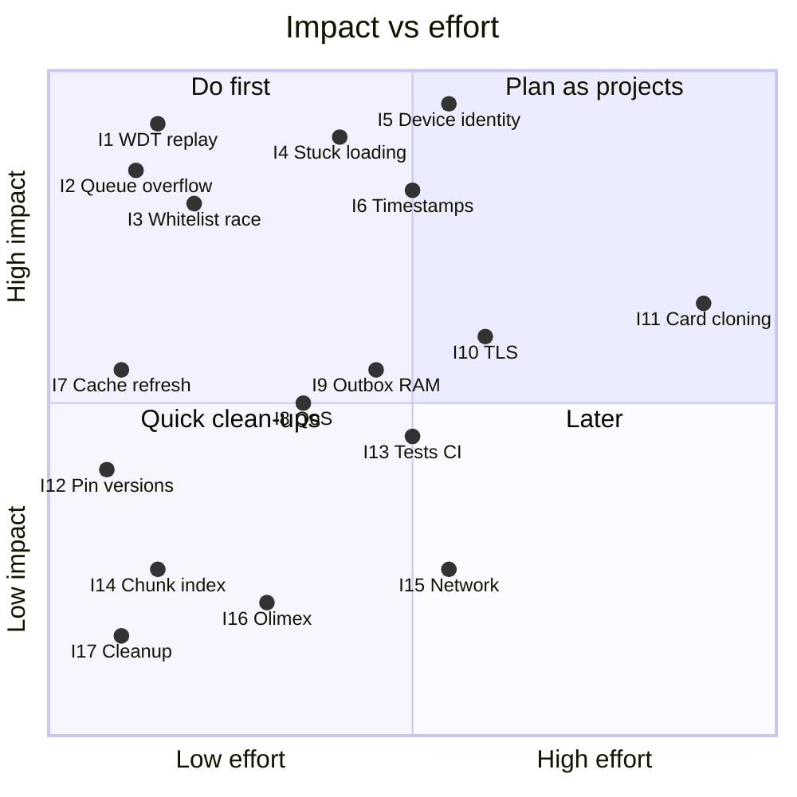

# 09 — Known issues & risks

Found by code review of commit `e6b5360`. None of these have been reproduced on hardware yet. Each one names the code, how it fails, and a suggested fix. Numbers are stable IDs referenced from other docs.

## Summary

| # | Issue | Severity | Area | Effort |
|---|---|---|---|---|
| 1 | Outbox replay can trip the watchdog → reboot loop + duplicates | **High** | Reliability | S |
| 2 | Read record can overflow the 64-byte queue item | **High** | Correctness | S |
| 3 | Whitelist set is read and written from two tasks without a lock | **High** | Stability | S |
| 4 | Whitelist sync denies everyone while loading, and can stay "loading" forever | **High** | Availability | M |
| 5 | Device identity hard-coded (topic, MAC, shared credentials) | **High** — blocks multi-reader schools | Deployment | M |
| 6 | Timestamps: no date, wrong after reboot, no DST | **High** — attendance data quality | Data | M |
| 7 | Cached whitelist not refreshed until 24 h of uptime | Medium | Data freshness | S |
| 8 | All MQTT traffic is QoS 0; `MQTT_QOS` flag is unused | Medium | Reliability | S–M |
| 9 | Outbox is unbounded and loaded fully into RAM; cleanup is not atomic | Medium | Reliability | M |
| 10 | No TLS; Wi-Fi password printed to serial | Medium | Security | M |
| 11 | Access relies on card UID only (cloneable), legacy block read with default key | Medium | Security / product | L |
| 12 | Unpinned platform and libraries | Medium | Build reproducibility | S |
| 13 | No automated tests or CI | Medium | Process | M |
| 14 | Chunk reassembly ignores chunk index | Low | Robustness | S |
| 15 | Network: no fail-back to Ethernet, one-shot NTP on Ethernet, blocking calls under mutex, not watchdog-watched | Low | Networking | M |
| 16 | Olimex variant cannot be built as-is | Low (depends on board decision) | Hardware | S |
| 17 | Dead code, unused dependency/flags, misleading names | Low | Maintainability | S |

---

## 1. Outbox replay can trip the watchdog → reboot loop + duplicates

- **Where:** [`MqttClient::processOutbox()`](../include/mqtt.h#L93), called from `process()` in the watched MQTT task.
- **What:** The whole outbox is published in one loop with `vTaskDelay(50 ms)` per record and **no `esp_task_wdt_reset()`**. Successfully sent lines are removed only **after** the loop.
- **Failure scenario:** After an outage with roughly 500+ buffered reads, the replay takes > 30 s → watchdog panic → reboot. Nothing was removed, so after reboot the same batch is replayed again and the device reboot-loops, flooding the backend with duplicates.
- **Fix:** Send a bounded batch per call (e.g. 20 records), call `esp_task_wdt_reset()` inside the loop, and remove sent records per batch.

## 2. Read record can overflow the 64-byte queue item

- **Where:** queue created with `sizeof(char[64])` ([`src/main.cpp:101`](../src/main.cpp#L101)); producer copies from a 128-byte buffer ([`include/nfc.h:177`](../include/nfc.h#L177)); consumer reads into `char received_data[64]` ([`include/mqtt.h:148`](../include/mqtt.h#L148)).
- **What:** `xQueueSend` copies exactly 64 bytes. If the record is ≥ 64 characters, the copied item has **no terminating NUL**, and `String(received_data)` reads past the buffer.
- **Failure scenario:** A 4-byte-UID card with a 19–20-digit legacy code: `15 + 20 + 8 + 16 + 1 + 4 = 64` chars → garbage appended to the event or a crash.
- **Fix:** Make the queue item 128 bytes (or a fixed struct), and always terminate on the consumer side. Also fix the stale comment "10 – max items".

## 3. Whitelist set is shared between tasks without a lock

- **Where:** [`Whitelist`](../include/whitelist.h) — `loadFromJson()` does `_cards.clear()` + inserts (MQTT task, inside the PubSubClient callback); `isAllowed()` does `_cards.count()` (NFC task, other core).
- **Failure scenario:** A card is tapped while a whitelist update is being applied → `std::set` is traversed while being rebuilt → wrong answer or a crash (`LoadProhibited`).
- **Fix:** Build the new set in a local variable, then swap it in under a mutex (and take the same mutex in `isAllowed()`). `_status` should be `std::atomic` or read under the same mutex.

## 4. Sync denies everyone, and can stay "loading" forever

- **Where:** [`MqttClient::process()` step 3](../include/mqtt.h#L203) calls `setLoading()` **before** the response arrives; `isReady()` is then false and [`Nfc::read()`](../include/nfc.h#L107) denies every card.
- **Failure scenarios:**
  - Every 24 h sync: all taps are denied until the response arrives, even though a valid list is in memory.
  - Response lost (QoS 0, broker restart, message > 4096 bytes silently dropped by PubSubClient, a malformed chunk, JSON error): status stays `LOADING`, `needsSync()` returns false for `LOADING`, and **nobody can enter until the reader reboots**.
- **Fix:** Keep the current set active during a sync (separate "sync in progress" flag from "list usable"); add a timeout that returns to `READY`/`EMPTY` and retries with backoff.

## 5. Device identity is hard-coded

- **Where:** topics `device/reader_real/...` ([`include/mqtt.h:23`](../include/mqtt.h#L23)); Ethernet MAC `0A:8A:DA:11:42:01` ([`include/network_manager.h:34`](../include/network_manager.h#L34)); one `MQTT_USER`/`MQTT_PASS` per build.
- **Failure scenarios (many readers per school):**
  - Two readers on one LAN share a MAC → ARP/DHCP conflicts, intermittent connectivity for both.
  - The backend cannot tell which entrance a read came from (entry vs exit, building).
  - A whitelist response is received by every reader; two simultaneous chunked transfers interleave and corrupt each other.
  - Mosquitto ACLs cannot separate readers; a leaked credential impersonates all readers.
- **Fix:** Derive the device id from the chip's eFuse MAC (`ESP.getEfuseMac()`), use it in topics (`device/<id>/...`) and as MQTT username, derive the Ethernet MAC from it, and provision per-device passwords. See [07 — ACL](07-mqtt-contract.md#mosquitto-acl).

## 6. Timestamps

- **Where:** [`include/timer.h`](../include/timer.h), [`network_manager.h:44`](../include/network_manager.h#L44).
- **What / scenarios:** payload carries only `HH-MM-SS` (no date); outbox records from a previous boot are converted with the new boot's sync point (wrong time); `00-00-00` before first NTP sync; fixed UTC+2 so summer times are one hour off (Ukraine uses UTC+3 in summer). Late-night replays get the wrong date on the backend.
- **Fix:** Store epoch seconds when time is known (`time(nullptr)`), otherwise `millis` + boot counter and fix up on sync; publish ISO 8601 UTC; use a POSIX TZ string (`EET-2EEST,M3.5.0/3,M10.5.0/4`) if local time is needed on the device at all.

## 7. Cached whitelist not refreshed until 24 h of uptime

- **Where:** `_loadFromFile()` sets `_lastSync = 0` and `READY` ([`include/whitelist.h:42`](../include/whitelist.h#L42)); `needsSync()` only fires after `millis() > 24 h`.
- **Scenario:** A new student is added on the backend; a reader that rebooted overnight keeps denying them for up to 24 h unless the backend pushes the list.
- **Fix:** Request a sync once after the first MQTT connection of each boot (without dropping to `LOADING`, see #4).

## 8. QoS 0 everywhere

- `PubSubClient::publish()` is always QoS 0, the whitelist subscription is QoS 0, and `-D MQTT_QOS=1` in `platformio.ini` is never read. "Published" only means "written to the TCP socket".
- **Fix:** Acceptable for events if the backend dedupes and the outbox is kept until the backend acknowledges (e.g. an ack topic with the `event_id`), or switch to a client that supports QoS 1 publish (e.g. `espMqttClient`, ESP-IDF `esp-mqtt`). Subscribe to the whitelist topic with QoS 1 (`subscribe(topic, 1)`).

## 9. Outbox is unbounded, read fully into RAM, cleanup not atomic

- **Where:** [`src/db.cpp`](../src/db.cpp) — `getAllReads()` builds a `std::vector<String>` of the whole file; `removeSentReads()` deletes then renames.
- **Scenarios:** A multi-day outage at a busy entrance → thousands of lines → heap exhaustion during replay. Power cut between `remove()` and `rename()` → the whole outbox is lost (`/outbox.tmp` is left behind and never recovered).
- **Fix:** Read and send in bounded batches (stream the file), cap the outbox size with an explicit drop policy, and recover `/outbox.tmp` at boot.

## 10. Transport security

- MQTT runs over plain TCP: credentials and student card UIDs travel unencrypted over the school LAN.
- [`network_manager.h:149-150`](../include/network_manager.h#L149) prints `WIFI_SSID` **and `WIFI_PASS`** to the serial console on every Wi-Fi attempt.
- **Fix:** Remove the password print now. Plan TLS: easy over Wi-Fi (`WiFiClientSecure`); for the W5500 path it needs a TLS layer such as `SSLClient`, or the internal-MAC Olimex variant, which uses lwIP for both links and so can use `WiFiClientSecure` there too.

## 11. Card security model (product risk)

- Access depends only on the card UID, which is not secret and is easy to clone with "magic" cards. The legacy code is read with the factory default key `FF FF FF FF FF FF` and is just as copyable.
- This is acceptable for attendance logging, but weak if the reader will ever unlock a door. Decide the threat model before adding an actuator ([10](10-roadmap-and-open-questions.md#open-questions)). Stronger options: MIFARE DESFire EV2/EV3 with diversified keys, or signed data on the card.

## 12. Unpinned platform and libraries

- `platform = espressif32` and `PubSubClient` / `ArduinoJson` have no version constraint. The code uses Arduino-ESP32 2.x / IDF 4 APIs (`esp_task_wdt_init(timeout, panic)`, `xQueueHandle`, `ARDUINO_EVENT_*`), which change or break on Arduino-ESP32 3.x / IDF 5.
- **Fix:** Pin `platform = espressif32@<tested version>` and all `lib_deps` to exact versions; record them in [08](08-development-guide.md).

## 13. No tests, no CI

- Pure logic that is easy to unit-test on the host (`pio test -e native`): `Whitelist::processChunk/loadFromJson`, `replaceMillisWithTime`, record building/parsing, the network state machine with a fake clock.
- A CI job running `pio run` on every push would at least catch build breaks (needs a dummy `secrets.h`).

## 14. Chunk index ignored

- [`processChunk()`](../include/whitelist.h#L60) appends parts in arrival order and only counts them. A duplicated or reordered chunk produces invalid JSON (→ #4) or, worse, valid JSON with wrong UIDs.
- **Fix:** Store parts by index, verify all indices `0..total-1` are present, and reject duplicates.

## 15. Networking details

- No fail-back from Wi-Fi to Ethernet when the cable returns.
- On W5500 Ethernet, NTP is synced once per connection and never refreshed (clock drift over long uptimes).
- `Ethernet.begin()` (≤ 10 s) and NTP (≤ 5 s) run while holding `networkClientMutex`.
- The network task is not registered with the watchdog; a hang there is invisible.
- MQTT task priority is 0 (same as the idle task).

## 16. Olimex variant cannot be built as-is

- It targets a classic ESP32 but there is no matching PlatformIO env; `main.cpp` never calls `networkManager.setup()`, which the Olimex manager needs. Steps: [08 — switching variant](08-development-guide.md#switching-hardware-variant).

## 17. Hygiene

- Unused: `tzapu/WiFiManager` dependency, `-D MQTT_QOS=1`, `MqttClient::taskFunction`, `Nfc`'s `DataBase` pointer, the static `ntpSynced` block in `Nfc::read()` ([`nfc.h:152`](../include/nfc.h#L152)), LED `error` state, `ETH_RST_PIN` / `ETH_INT_PIN`.
- `Melody(notes, durations, 300, 4)`: the field called `length` is the whole-note duration in ms and the field called `duration` is the note count — swapped names.
- The env is named `esp32dev` but builds for `esp32s3box`.
- `timer.h` contains time-formatting helpers, not a timer.
- Comments are mixed Ukrainian/English with "CHANGED/ADDED/CRITICAL FIX" history notes, which belong in git history instead.
