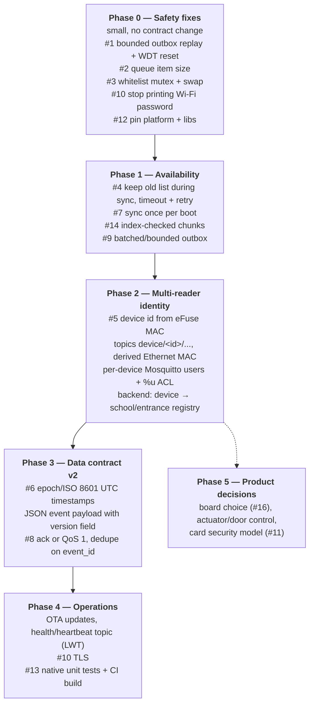
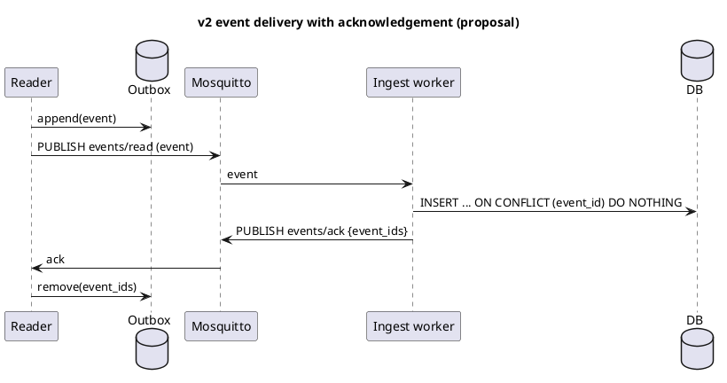

# 10 — Roadmap & open questions

This is a suggested order of work, based on the issues in [09](09-known-issues-and-risks.md). It has no dates because effort depends on the team. Every phase leaves the device deployable.

## Suggested phases



Why this order:

- **Phase 0** fixes crashes and data corruption that can happen on a single reader today; each fix is a few lines.
- **Phase 1** stops a reader from locking out every card, which is the most visible failure for a school.
- **Phase 2** has to land before more than one reader goes on the same LAN or broker.
- **Phase 3** changes the MQTT contract, so plan it together with the Python backend team and support both formats during rollout (readers may still hold old records in their outbox).
- **Phase 4** makes a fleet manageable without visiting each entrance with a USB cable.

### Proposed v2 contract (for discussion)

```text
device/<device_id>/events/read          reader → backend   JSON event
device/<device_id>/events/ack           backend → reader   {"event_ids": [...]}      (optional, enables at-least-once)
device/<device_id>/whitelist/request    reader → backend   {"have_version": "<hash>"}
device/<device_id>/whitelist/response   backend → reader   chunked, with version + checksum
device/<device_id>/status               reader → backend   retained "online"/"offline" (LWT), fw version, uptime, outbox size
```

```json
{
  "v": 2,
  "event_id": "3f9a1c0e5b7d2a41",
  "uid": "04:7B:37:C9",
  "legacy_code": null,
  "ts": "2026-10-02T05:15:42Z",
  "ts_source": "ntp",
  "allowed": true,
  "whitelist_version": "a1b2c3"
}
```



## Open questions

Decisions the team (mentors + PM + backend) still has to make. The answers change the firmware design.

| # | Question | Why it matters | Affects |
|---|---|---|---|
| Q1 | **Which board is the production target:** Waveshare ESP32-S3 + W5500, or Olimex ESP32-POE (LAN8720, PoE)? | Driver code, TLS options, power at the entrance, BOM cost | [02](02-hardware.md), #16, #10 |
| Q2 | Does the reader (or another component) **control a door/turnstile**, or is it attendance-only? | Security model, fail-open vs fail-closed policy, need for a relay output | #4, #11 |
| Q3 | What exactly is the **legacy code** in MIFARE block 4, and is it still needed? | It is read with the default key and is part of the payload | [04](04-card-read-flow.md), #2 |
| Q4 | Is the whitelist **per school, per entrance, or per reader**? Do some people have time-based access? | Topic design, payload size, whether the device needs schedules | [07](07-mqtt-contract.md) |
| Q5 | How long must a reader **work offline**, and how many reads per day per entrance? | Outbox size limit and drop policy | #9 |
| Q6 | How are readers **provisioned** (device id, broker credentials, Wi-Fi)? Who holds the secrets? | Today credentials are compiled into the firmware | #5, #10 |
| Q7 | Does the backend need the **exact date/time** from the device, or is receive time enough? | Decides how much of #6 is needed | #6 |
| Q8 | Are card UIDs and access events treated as **personal data** of minors (retention, access rights, encryption)? | Transport encryption, log contents (UIDs are printed to serial), backend retention | #10 |
| Q9 | Who owns and versions the **MQTT contract** between firmware and backend? | Keeps [07](07-mqtt-contract.md) and the Python workers in sync | Process |
