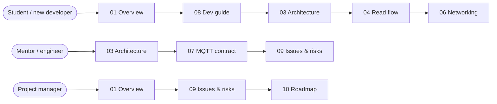

# Prohidna Reader — Developer Documentation

Firmware for the **NFC entrance reader** of the Prohidna school entrance control platform.
The reader sits at a school entrance, reads student/staff cards, decides locally whether the card is allowed, gives instant light + sound feedback, and reports every read to the platform backend over MQTT.

> Status: working prototype firmware (2 commits, no automated tests). See [09 — Known issues & risks](09-known-issues-and-risks.md) before deploying to many entrances.

## Documents

| # | Document | What you will learn |
|---|----------|---------------------|
| 01 | [System overview](01-system-overview.md) | Where the reader fits in the platform, glossary, tech stack, project status |
| 02 | [Hardware](02-hardware.md) | Components, wiring and pin maps of both board variants |
| 03 | [Firmware architecture](03-firmware-architecture.md) | Modules, FreeRTOS tasks, shared resources, boot sequence, design patterns |
| 04 | [Card read flow](04-card-read-flow.md) | What happens from tapping a card to the green/red light and the queued event |
| 05 | [Storage, outbox & time](05-storage-outbox-and-time.md) | LittleFS files, offline store-and-forward, timestamp conversion |
| 06 | [Networking](06-networking.md) | Ethernet ⇄ Wi-Fi failover state machine, NTP sync |
| 07 | [MQTT contract](07-mqtt-contract.md) | Inter-service communication with the Python backend: topics, payloads, whitelist sync, ACL |
| 08 | [Development guide](08-development-guide.md) | Setup, `secrets.h`, build/flash/monitor, local testing with Mosquitto, conventions |
| 09 | [Known issues & risks](09-known-issues-and-risks.md) | Ranked defects and risks with file references |
| 10 | [Roadmap & open questions](10-roadmap-and-open-questions.md) | Suggested work order, decisions the team still has to make |

## Reading paths



- **Students:** start with 01 and 08 to get a device building, then read 03 → 04 → 05 → 06 in order. Each document is self-contained and links to the exact source lines.
- **Mentors:** 03, 07 and 09 contain the design analysis, concurrency model and the defect list.
- **Project management:** 01 (status and scope), the summary table at the top of 09, and 10.

## Diagrams

- **Mermaid** blocks render natively on GitHub, GitLab and in VS Code's Markdown preview.
- **PlantUML** blocks (` ```plantuml `) need a renderer: the VS Code *PlantUML* extension (jebbs.plantuml), IntelliJ's PlantUML plugin, or the public server at <https://www.plantuml.com/plantuml>. Do not paste diagrams containing real hostnames or credentials into public servers.

## Conventions used in these docs

- Source references look like [`include/mqtt.h:93`](../include/mqtt.h#L93) and point at the code as of commit `e6b5360`.
- "Reader" = one physical device running this firmware. "Backend" = the Python API + MQTT workers. "Broker" = Mosquitto.
